# Day 1: Cloud, Containers and DevOps

**What you'll get out of today:** a mental map of the cloud (what it is, how AWS, Azure and Google Cloud compare, who is responsible for what), a working understanding of Docker, and a laptop that's ready for Day 2. At the end you'll **build a game into a container and play it** to prove your setup works.


<p align="center">
  <a href="https://github.com/aaaditt/acm-cloud-devops-workshop">
    
  </a>
</p>

---


## 1. Where this can take you

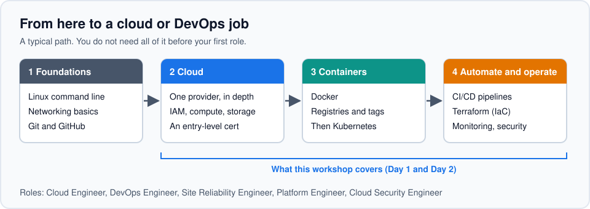

Most people who end up in cloud or DevOps jobs follow roughly this path. Linux, networking and Git come first. Then they learn one cloud properly, then containers, then the automation that ties it all together. These two days cover steps 2 and 3, plus a first taste of step 4.

You don't need to finish the whole roadmap before applying for anything. Plenty of people get a first cloud or junior DevOps role after step 2 or 3 and learn the rest on the job. Certifications are optional. If you want one, pick a single cloud's entry-level cert rather than all three.

Each part below starts with a short look at the jobs that part leads to.

---


## 2. The cloud in plain words

### 2.1 Career prospects

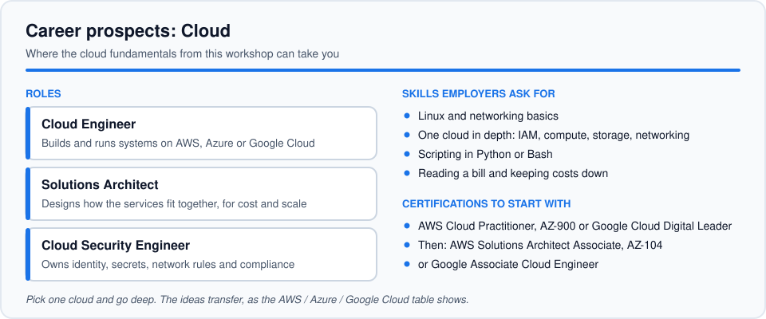

Nearly every company now runs at least part of its software on a cloud provider, so people who understand how the cloud works are in demand well beyond tech firms. 
- A **Cloud Engineer** builds and runs things on AWS, Azure or Google Cloud. 
- A **Solutions Architect** decides how the pieces should fit together. 
- A **Cloud Security Engineer** looks after identity, secrets and access. 
Everything in this part and the next is the groundwork for those roles.

### 2.2 What is "the cloud"?

Renting someone else's computers over the internet, by the minute, instead of buying your own.

| | On-premises (your own servers) | Cloud |
| --- | --- | --- |
| Cost | Pay for hardware up front (CapEx) | Pay for what you use (OpEx) |
| Speed | Weeks to order and install | Minutes to start |
| Capacity | Guess, then over-buy | Grow and shrink on demand (**elasticity**) |

Think of it as buying a car vs using a ride-hailing app. The cloud isn't always cheaper, but you get capacity in minutes and only pay while you use it.

### 2.3 IaaS, PaaS, SaaS: how much do you manage?

| Model | Think of it as… | You manage | Examples |
| --- | --- | --- | --- |
| **IaaS** (Infrastructure) | Renting an empty flat | The OS, runtime and your app | AWS EC2, Azure VMs, Google Compute Engine |
| **PaaS** (Platform) | Renting a furnished flat | Just your app | **Google Cloud Run**, App Engine, Azure App Service |
| **SaaS** (Software) | A hotel room | Nothing, just use it | Gmail, Google Docs, Zoom |

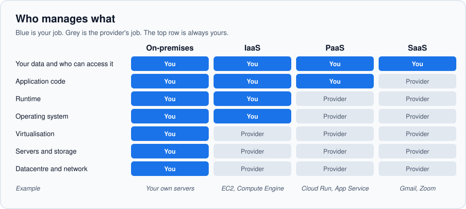

> On Day 2 you deploy to **Cloud Run** (PaaS). You never touch an operating system.

### 2.4 Public, private, hybrid

- **Public cloud:** shared provider infrastructure (AWS, Azure, Google Cloud)
- **Private cloud:** infrastructure used by one organisation only
- **Hybrid:** a mix, e.g. sensitive data on-premises, the website in the public cloud

### 2.5 Where the cloud physically lives

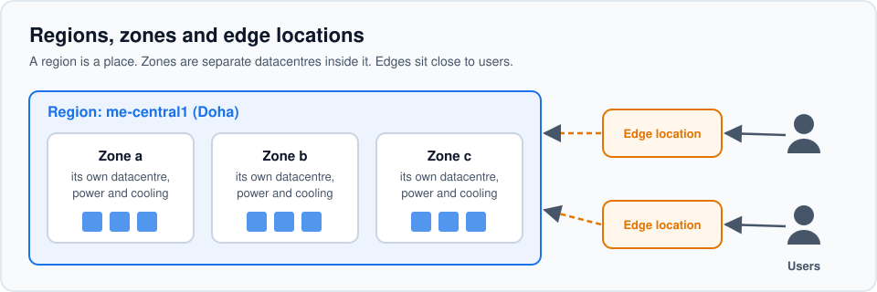

- **Region:** a geographic area with datacentres
- **Availability zone:** a separate datacentre inside a region, so one failure doesn't take you down
- **Edge location:** a small site near users that caches content

Region choice matters for **latency** (closer is faster), **data residency** (some laws keep data in-country) and **price**.

Nearby: AWS has a UAE region; Azure has UAE North (Dubai) and UAE Central (Abu Dhabi); Google Cloud's nearest are `me-central1` (Doha) and `me-central2` (Dammam). **Day 2 uses `me-central1`.**

### 2.6 Shared responsibility: who secures what?

| Layer | IaaS | PaaS | SaaS |
| --- | --- | --- | --- |
| Datacentre and hardware | Provider | Provider | Provider |
| Operating system | **You** | Provider | Provider |
| Runtime and platform | **You** | Provider | Provider |
| Your app's code and config | **You** | **You** | Provider |
| Your data and who can access it | **You** | **You** | **You** |

> The provider secures **the cloud**. You secure **what you put in it**. The bottom row never moves: if you leak your own API key, that's on you in every model. That's why on Day 2 your AI key goes in Secret Manager, never in code.

### 2.7 Scaling and pricing

- **Scale up:** a bigger machine. **Scale out:** more machines (usually preferred)
- **Elasticity:** adding and removing resources automatically as demand changes
- **Pay-as-you-go** bills you for usage; **free tiers and trial credits** are for learning
- **Idle resources can still cost money.** A VM bills even with zero visitors. Cloud Run scales to zero, but always delete what you don't need

---

## 3. AWS, Azure and Google Cloud side by side

The three big clouds offer the same building blocks under different names. Learn the idea once and you can translate.

### 3.1 How each cloud organises your stuff

| AWS | Azure | Google Cloud |
| --- | --- | --- |
| Organization → account → region → resources | Tenant → subscription → **resource group** → resources | Organization → folders → **project** → resources |
| Tags | Tags | Labels |

> On Google Cloud, a **project** is the box that holds everything for one app: resources, permissions, billing and enabled APIs. **Delete the project and everything inside goes with it.** On Day 2 you create one, and delete it at the end.

> **Tags / Labels** are `name = value` notes you stick on resources, like `env = prod` or `team = payments`. They don't change how anything runs, but they let you split the bill by team, find resources quickly, and automate things like "shut down everything labelled `env = dev` at night". (Google Cloud also has a separate feature called *tags*, used for access and firewall rules. Its equivalent of AWS/Azure tags is *labels*.)

### 3.2 The cheat sheet 

| Area | AWS | Azure | Google Cloud | The idea |
| --- | --- | --- | --- | --- |
| Virtual machines | EC2 | Virtual Machines | Compute Engine | Rentable servers sized by CPU and memory |
| Object storage | S3 | Blob Storage | Cloud Storage | Files over HTTP |
| Identity | IAM | Entra ID + RBAC | Cloud IAM + service accounts | Least privilege: only the access needed |
| Network | VPC | VNet | VPC | Your private network |
| Firewall | Security groups | NSGs | Firewall rules | Who can talk to what |
| Database | RDS | Azure SQL | Cloud SQL | Provider handles backups and patching |
| Serverless functions | Lambda | Azure Functions | Cloud Run functions | Run code on events, no server |
| Container registry | ECR | ACR | Artifact Registry | Store your Docker images |
| Run containers | ECS / Fargate | Container Apps / ACI | Cloud Run  | Run an image, get a URL |
| Kubernetes | EKS | AKS | GKE | Orchestrate many containers |
| App hosting | Elastic Beanstalk | App Service | App Engine / Cloud Run | Upload your app, it runs |
| Secrets | Secrets Manager | Key Vault | Secret Manager | Keep keys out of your code |
| AI models | Bedrock | Azure OpenAI | Vertex AI / Gemini | Call an AI model via an API |
| Grouping | Account, tags | Subscription, resource group | Project , labels | One box per app |

### 3.3 How do companies choose?

Existing tools (Microsoft shops lean Azure; Google Workspace and data/AI teams often lean GCP), pricing deals and credits, team skills, compliance and data residency. Plenty use more than one.

---

## 4. Docker and containers

### 4.1 Career prospects

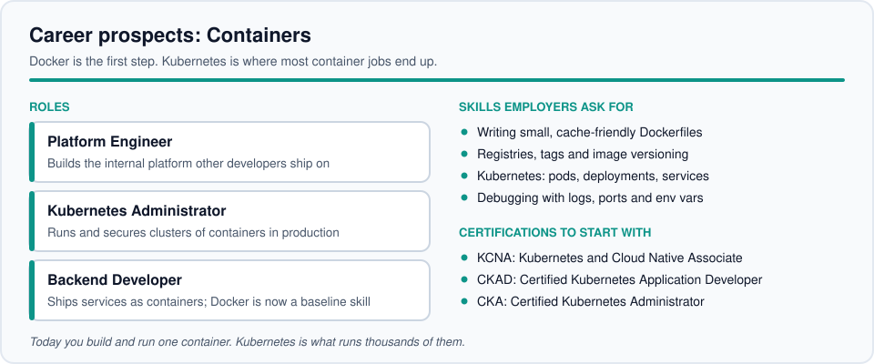

Containers are how most new software gets shipped, so Docker has gone from a nice extra to something employers simply expect. It shows up in backend and full-stack job posts as often as in ops ones. If you enjoy this part, the next step is Kubernetes, which runs containers at scale. That leads to **Platform Engineer** and **Kubernetes Administrator** roles, and the CKAD and CKA certifications are well known in hiring.

### 4.2 The problem containers solve

"It works on my machine." Your app needs the right Python version, the right packages, the right settings. A **container** packages the app *with* everything it needs, so it runs the same on your laptop, your friend's laptop and the cloud.

### 4.3 Containers vs virtual machines

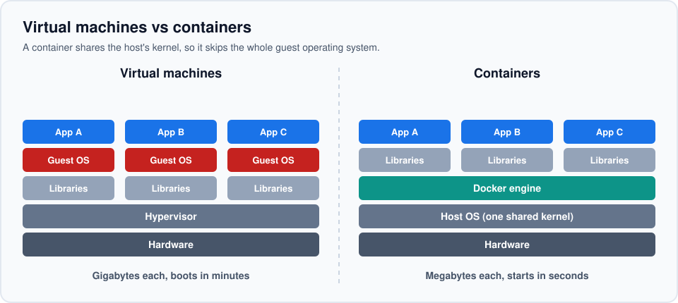

| | Virtual machine | Container |
| --- | --- | --- |
| What's inside | A full guest operating system + your app | Just your app and its dependencies (shares the host's OS kernel) |
| Size | Gigabytes | Megabytes |
| Start time | Minutes | Seconds |
| How many per machine | A few | Many |

A container is an **isolated process**, not a mini-VM.

### 4.4 Images, containers and layers

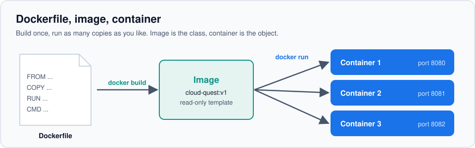

- **Image:** a read-only template, like a class in programming
- **Container:** a running instance of an image, like an object. One image → many containers
- **Layers:** each Dockerfile instruction makes a layer, and Docker **caches** unchanged layers. Put slow, rarely-changing steps (installing packages) first and often-changing steps (your code) last

### 4.5 A Dockerfile, line by line

```dockerfile
# Start from a small official Python image
FROM python:3.12-slim

# Work inside /app in the image
WORKDIR /app

# Copy ONLY the requirements first, so the slow install layer stays cached
COPY requirements.txt .
RUN pip install -r requirements.txt

# Now copy the rest of your code
COPY . .

# Document the port the app listens on
EXPOSE 8080

# What runs when a container starts
CMD ["python", "app.py"]
```

| Instruction | What it does |
| --- | --- |
| `FROM` | Base image to start from |
| `WORKDIR` | Working folder inside the image |
| `COPY` | Copy files from your machine into the image |
| `RUN` | Run a command at **build** time (install things) |
| `EXPOSE` | Document the port (doesn't publish it by itself) |
| `CMD` | Command that runs at **container start** |

Here's what the layer cache does with that Dockerfile when you only edit your code:

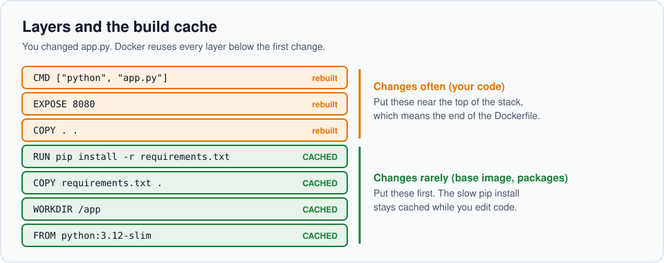

> **`RUN` vs `CMD`** is the classic mix-up. `RUN` happens once while *building*. `CMD` happens every time a container *starts*.

### 4.6 Registries, names and tags

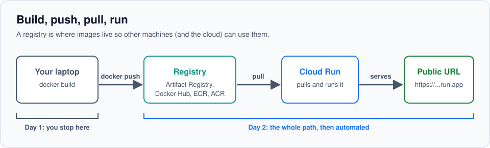

- Full image name: `registry/name:tag`. On Google Cloud it looks like `me-central1-docker.pkg.dev/my-project/my-repo/myapp:v1`
- Registries: Docker Hub, Google Artifact Registry, Amazon ECR, Azure ACR
- **Avoid `:latest`.** It's a moving label, so you can't tell which version is running. Use explicit tags like `:v1`
- **`.dockerignore`** keeps `.git`, secrets and junk out of your image

### 4.7 Ports and lifecycle

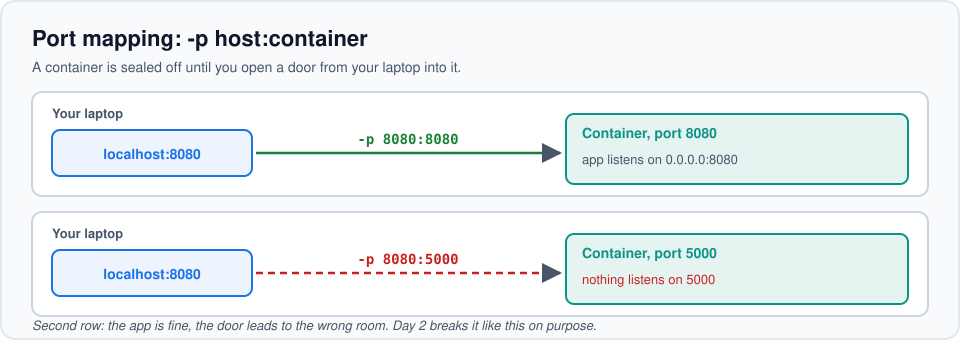

- `-p 8080:8080` means **host port : container port**. Containers are isolated until you map a port
- Containers are **disposable**: anything saved inside is lost when the container is removed. **Volumes** are storage that outlives a container; **Docker Compose** runs several containers together from one file

### 4.8 Commands you'll use

```bash
docker build -t myapp:v1 .         # build an image from the Dockerfile in this folder
docker run -p 8080:8080 myapp:v1   # start a container, map the port
docker ps                          # list running containers
docker ps -a                       # ...including stopped ones
docker logs <container-id>         # see what the app printed
docker stop <container-id>         # stop it
docker rm <container-id>           # delete it
docker images                      # list images on your machine
```

---

## 5. DevOps and CI/CD

### 5.1 Career prospects

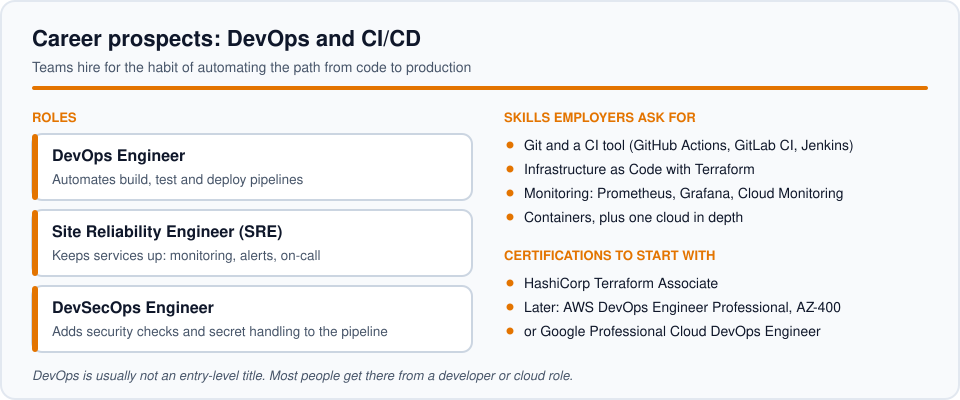

DevOps work is about making releases boring: automated, repeatable and safe. 
- **DevOps Engineers** build the pipelines 
- **Site Reliability Engineers** keep services running and get paged when they don't 
- **DevSecOps Engineers** build security checks into the pipeline. 

These are rarely first jobs. Most people move into them after a year or two as a developer or cloud engineer, so the habits you start building here pay off later.

### 5.2 What DevOps and CI/CD mean

- **DevOps** is a culture and set of practices where developers and operations work together and **automate** the path from code to production. It's not a job title or a tool, even though both get labelled with it.
- **CI (Continuous Integration):** every push triggers an automated build and tests.
- **CD:** continuous *delivery* means it's ready to release and a human clicks the button; continuous *deployment* means it ships automatically.

### 5.3 The pipeline: from `git push` to a live URL

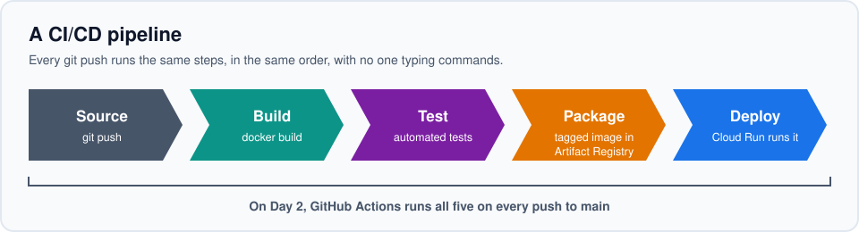

The **image is the artifact**: the exact image that passed the tests is what runs in production. On Day 2, **GitHub Actions** runs this whole pipeline every time you push.

---

## 6. Setup lab: play Cloud Quest

Now you prove your setup works. **Cloud Quest** is a five-level game about everything from today, and you're going to run it inside a Docker container you build yourself. Nothing gets deployed today; it only runs on your laptop. (Deploying to the cloud is Day 2.)

Code: [github.com/aaaditt/acm-cloud-devops-workshop](https://github.com/aaaditt/acm-cloud-devops-workshop)

### 6.1 Check your tools

```bash
docker run hello-world      # Docker works
gcloud version              # Google Cloud CLI installed
gcloud auth login           # you can sign in
git --version               # Git installed
```


### 6.2 Build the game

Skip the clone if you already did it during setup.

```bash
git clone https://github.com/aaaditt/acm-cloud-devops-workshop.git cloud-quest
cd cloud-quest
docker build -t cloud-quest:v1 .
```

Open the `Dockerfile` while it builds. It's the same Dockerfile from section 4.5.

> **On an Apple Silicon Mac?** This works as is. (On Day 2 you'll add `--platform linux/amd64` for Cloud Run.)

### 6.3 Run it and play

```bash
docker run -p 8080:8080 cloud-quest:v1
```

Open **http://localhost:8080**, enter your name and play the five levels:

1. **Guess the Model:** IaaS, PaaS or SaaS?
2. **Whose Fault?** Shared responsibility scenarios
3. **Cloud Translator:** AWS ↔ Azure ↔ Google Cloud
4. **Spot the Bugs:** find 3 bugs in a Dockerfile
5. **Build the Pipeline:** put CI/CD in order


### 6.4 Bonus: see Docker in action

- Look at the footer: **"Served by container a1b2c3…"**. In a second terminal, run `docker ps`. The ID matches, because that's your container.
- Start a **second** container from the **same image** with different config:

  ```bash
  docker run -p 8081:8080 -e VERSION=v2 cloud-quest:v1
  ```

  Open http://localhost:8081. The footer shows `v2` and a different container ID: same image, different behaviour, set by `-e`. Day 2 uses exactly this trick for your AI key.
- Clean up: `docker ps`, then `docker stop <id>` for each container.

If you can play the game, your setup works.

---

## 7. Glossary

| Term | Meaning |
| --- | --- |
| Region / zone | Where datacentres are; a zone is one datacentre inside a region |
| IaaS / PaaS / SaaS | How much the provider manages: servers / platform / whole app |
| Elasticity | Automatically adding and removing resources as demand changes |
| Project (GCP) | The box holding everything for one app, including billing; delete it to delete everything |
| Image | Read-only template for a container |
| Container | A running instance of an image |
| Layer | One cached step of an image build |
| Registry | Where images are stored (Artifact Registry, Docker Hub, ECR, ACR) |
| Tag | Version label on an image (`:v1`). Avoid `:latest` |
| Port mapping | `-p host:container`, opening a container's port to your machine |
| Environment variable | Config passed at run time (`-e NAME=value`), kept out of the image |
| CI / CD | Automatic build and test / automatic release |
| Artifact | The thing you ship; for us, the Docker image |
| Service account | A robot identity for automation (GitHub Actions uses one on Day 2) |

---

## 8. Troubleshooting

| Problem | Fix |
| --- | --- |
| `docker` not recognised | Open a new terminal. Still failing? Restart the computer and check Docker Desktop is installed and running |
| `Cannot connect to the Docker daemon` | Open Docker Desktop and wait for the steady whale. On Windows, check WSL 2 is installed and virtualization is on in the BIOS |
| Docker blocked on a work laptop | Company policy may block it. Pair with someone whose setup works |
| `docker build` is very slow | It's downloading the base image. Next time, pre-pull: `docker pull python:3.12-slim` |
| `port is already allocated` | Something already uses 8080. `docker ps`, then `docker stop <id>`, or use `-p 8081:8080` |
| Game won't load at localhost:8080 | Check you used `-p 8080:8080` and the container is running (`docker ps`) |
| `COPY failed: file not found` | You're in the wrong folder. `cd cloud-quest` (the folder `git clone` created) first |
| `gcloud` not recognised | Open a new terminal. On Windows, re-run the installer with "add to PATH" ticked |
| `gcloud auth login` opens no browser | Run `gcloud auth login --no-launch-browser` and follow the link |
| No billing account after signing in | Finish the free trial at cloud.google.com/free, or pair for Day 2 |
| Card rejected | Don't burn lab time on it. Pair for Day 2 |
| `git clone` fails | Check the link in the chat and that you copied all of it |
