# Data Analytics (Day 1)

## 1. Framing

### 1.1 Roadmap to data careers

"Data" is not one job. Think of a data team as three groups that hand work to each other.

export const RolesRoadmap = () => {
  const [sel, setSel] = useState(0);
  const roles = [
    { name: "Data Engineering", tag: "The builders", color: "#3B82F6", does: "Build and maintain the pipelines that collect, move and store data reliably.", daily: ["Pull data from apps and databases", "Schedule jobs that run every night", "Fix pipelines when they break"], tools: "SQL, Python, Snowflake, BigQuery", here: "Loading and cleaning dataset.csv in Power Query.", day: "Streams data from the music app into the warehouse, so everyone else has clean tables to work with." },
    { name: "Data Analytics", tag: "The storytellers", color: "#1DB954", does: "Turn data into charts and dashboards that help people make decisions.", daily: ["Build and refresh dashboards", "Answer questions like which genres are growing", "Present findings to non-technical teams"], tools: "Power BI, Excel, SQL", here: "Building the Power BI dashboard on Day 2.", day: "Shows the marketing team which genres and moods are trending, so they know where to spend their budget." },
    { name: "Data Science", tag: "The predictors", color: "#F59E0B", does: "Build models that predict what will happen next.", daily: ["Choose features and train models", "Test whether predictions hold up on new data", "Explain results and limits to stakeholders"], tools: "Python, scikit-learn, Colab", here: "Training the random forest that predicts viral probability.", day: "Builds the model that estimates which unreleased tracks are most likely to take off." },
  ];
  const r = roles[sel];
  return (
    

      
Try it: explore the three roles

      
Tap a role to see what the job looks like day to day.

      

        {roles.map((x, i) => (
          <button key={x.name} onClick={() => setSel(i)} className="px-3 py-1 rounded-md border border-zinc-300 dark:border-zinc-600" style={sel === i ? { background: x.color, color: "white", borderColor: x.color } : {}}>{x.name}</button>
        ))}
      

      

        
{r.tag}

        
{r.does}

        
A typical week

        <ul className="mt-1 mb-2">
          {r.daily.map((d) => <li key={d}>{d}</li>)}
        </ul>
        
<strong>Tools:</strong> {r.tools}

        
<strong>At a music company:</strong> {r.day}

        
<strong>In this workshop:</strong> {r.here}

      

    

  );
};

<RolesRoadmap />

<CardGroup cols={3}>
  <Card title="Data Engineering" icon="hammer">
    **The builders.** Build the pipes that collect, move and store data reliably. Tools: SQL, Python, cloud warehouses.
  </Card>
  <Card title="Data Analytics" icon="chart-column">
    **The storytellers.** Turn data into charts and dashboards that help people decide. Tools: Power BI, Excel, SQL.
  </Card>
  <Card title="Data Science" icon="wand-magic-sparkles">
    **The predictors.** Build models that forecast what happens next. Tools: Python, scikit-learn.
  </Card>
</CardGroup>

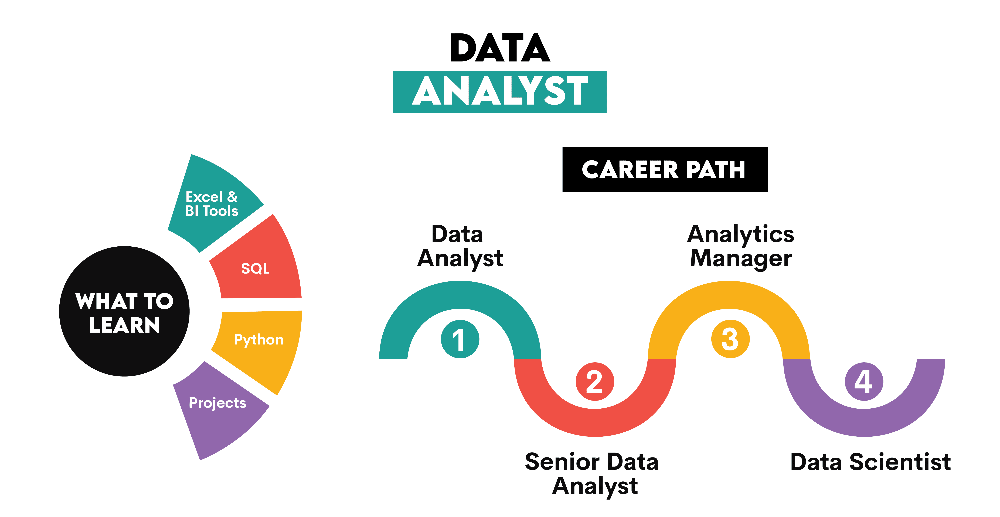

<Tip>
In this workshop, you will play all three roles. You will clean data as a data engineer, build a dashboard as a data analyst, and train a model as a data scientist.
</Tip>

**How the three roles work together**

The roles are links in a chain. Each one depends on the one before it.

| Stage | Who | Hands over |
| --- | --- | --- |
| Collect and store data | Data engineer | Clean, reliable tables |
| Explore and explain data | Data analyst | Dashboards and insights |
| Predict what happens next | Data scientist | A model and its predictions |

If the data pipeline introduces errors, the dashboard can show misleading results and the model can learn from incorrect data. That is why all three roles need a basic understanding of each other.

**Skills at a glance**

|  | Engineering | Analytics | Science |
| --- | --- | --- | --- |
| **Core question** | Is the data available and correct? | What happened, and why? | What will happen next? |
| **Main skills** | SQL, Python, cloud platforms | SQL, Power BI, Excel, storytelling | Python, statistics, machine learning |
| **Main output** | Pipelines and tables | Dashboards and reports | Models and forecasts |
| **Mindset** | Reliability | Clarity | Experimentation |

### 1.2 How do labels quantify a "hit"?

Every day, around 100,000 new tracks are uploaded to streaming platforms. Almost nobody hears most of them. A record label has to decide where to put its marketing money.

Songs don't come with a "hit" label, so we need to define one. We will say a track is **viral** if its popularity score is above a threshold (you will choose it on Day 2). That turns the business problem into a yes/no prediction.

**What a good prediction problem looks like**

Before building a model, ask:

1. **What decision are we depending on the model for?** (Where to spend marketing money.)
2. **Do we have past examples with known outcomes?** (Tracks with popularity scores.)
3. **Can we measure the inputs before the outcome happens?** (Audio features exist before release.)
4. **How will we know it worked?** (Accuracy on tracks the model has never seen.)

### 1.3 What you will build on Day 2

{/* ILLUSTRATION I-03: Preview of the finished product. Short screen recording: dashboard filtering by genre, then a slider panel where energy/danceability change a "viral probability" gauge. */}

Here is a preview of the end result: a dashboard exploring popularity, and a model where you move sliders for a new song's features and watch the predicted probability of going viral change.

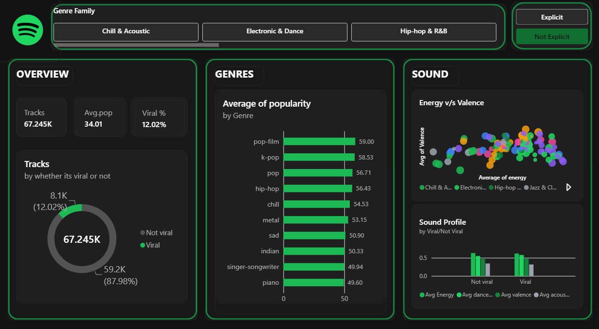

**Key terms you will hear this week**

| Term | Plain-English meaning |
| --- | --- |
| **Dataset** | A table of data: rows are items, columns are details |
| **Feature** | An input column the model uses |
| **Target** | The column we want to predict |
| **Dashboard** | A page of linked charts you can filter |
| **Model** | A pattern-finding recipe learned from data |
| **Prediction** | The model's estimate for something new |

export const Reveal = ({ question, answer }) => {
  const [show, setShow] = useState(false);
  return (
    

      
{question}

      <button onClick={() => setShow(!show)} className="mt-2 px-3 py-1 rounded-md text-sm font-semibold" style={{ background: show ? "transparent" : "#1DB954", color: show ? "inherit" : "white", border: "1px solid #1DB954" }}>{show ? "Hide answer" : "Reveal answer"}</button>
      {show ? 
{answer}
 : null}
    

  );
};

---

## 2. The Data Ecosystem

### 2.1 What kind of data are we dealing with?

A **CSV** (comma-separated values) file stores a table as plain text. The first row usually names the columns, and each following row contains one record. In our Spotify file, each record describes a track, with columns for values like genre and popularity. When you import a CSV, check how your tool interprets each column. For example, an ID like `00123` can lose its leading zeros if it is read as a number.

| Type | What it looks like | Example |
| --- | --- | --- |
| **Structured** | Neat rows and columns | Our Spotify CSV |
| **Semi-structured** | Flexible, labelled fields (JSON, XML) | An app's API response |
| **Unstructured** | No fixed layout | Audio files, images, social posts |

Today's data is structured. The audio features (`danceability`, `energy` and so on) were _computed_ from unstructured audio files.

**Common file formats**

| Format | Best for | Notes |
| --- | --- | --- |
| **CSV** | Simple tables | Human-readable, but no data types and large files are slow |
| **JSON** | Data from web APIs | Handles nested information |
| **Parquet** | Big data in warehouses | Compressed and fast to read |

### 2.2 Where does data live?

| | On-premises | Cloud data warehouse |
|---|---|---|
| **Where** | Servers the company owns and runs | Rented from a provider over the internet |
| **Cost model** | Large upfront purchase | Pay for what you use |
| **Scaling** | Buy more machines | Click a button |
| **Examples** | A university's own server room | Snowflake, Google BigQuery |

export const CloudToggle = () => {
  const [mode, setMode] = useState("cloud");
  const [size, setSize] = useState(2);
  const onprem = (n) => 40 * Math.ceil(n / 3);
  const cloud = (n) => 10 + 6 * n;
  const sizes = Array.from({ length: 10 }, (_, i) => i + 1);
  const x = (n) => 40 + ((n - 1) / 9) * 320;
  const y = (c) => 170 - (c / 170) * 150;
  const stepPts = sizes.map((n) => { const prev = n === 1 ? onprem(1) : onprem(n - 1); return x(n) + "," + y(prev) + " " + x(n) + "," + y(onprem(n)); }).join(" ");
  const cloudPts = sizes.map((n) => x(n) + "," + y(cloud(n))).join(" ");
  const servers = Math.ceil(size / 3);
  const boxes = Array.from({ length: servers }, (_, i) => i);
  const here = mode === "cloud" ? cloud(size) : onprem(size);
  const btn = "px-3 py-1 rounded-md border border-zinc-300 dark:border-zinc-600";
  return (
    

      
Try it: grow the company

      
Switch the setup, then drag the slider to grow the amount of data stored.

      

        <button className={btn} onClick={() => setMode("onprem")} style={mode === "onprem" ? { background: "#F59E0B", color: "white" } : {}}>On-premises</button>
        <button className={btn} onClick={() => setMode("cloud")} style={mode === "cloud" ? { background: "#1DB954", color: "white" } : {}}>Cloud warehouse</button>
      

      

        {mode === "onprem"
          ? boxes.map((b) => Server {b + 1})
          : Cloud: using {size} TB, paying for {size} TB}
      

      <svg viewBox="0 0 380 200" className="w-full">
        <line x1="40" y1="170" x2="360" y2="170" stroke="currentColor" strokeOpacity="0.3" />
        <line x1="40" y1="20" x2="40" y2="170" stroke="currentColor" strokeOpacity="0.3" />
        <polyline points={stepPts} fill="none" stroke="#F59E0B" strokeWidth={mode === "onprem" ? 4 : 2} />
        <polyline points={cloudPts} fill="none" stroke="#1DB954" strokeWidth={mode === "cloud" ? 4 : 2} />
        <line x1={x(size)} y1="20" x2={x(size)} y2="170" stroke="currentColor" strokeOpacity="0.5" strokeDasharray="4" />
        <text x="45" y="16" fontSize="10" fill="currentColor">relative cost</text>
        <text x="250" y="194" fontSize="10" fill="currentColor">data stored (TB) &rarr;</text>
      </svg>
      <input type="range" min="1" max="10" value={size} onChange={(e) => setSize(Number(e.target.value))} className="w-full" />
      
&#9632; On-premises  &#9632; Cloud. At {size} TB your cost is <strong>{here}</strong>.

      
{mode === "onprem" ? "On-premises costs jump each time you outgrow your servers: you buy a whole new one." : "Cloud costs grow smoothly because you only pay for what you use."}

      
Illustrative numbers for teaching, not real prices.

    

  );
};

<CloudToggle />

A streaming platform that stores billions of plays a day cannot realistically fit that into a single office server, which is why most use cloud warehouses.

### 2.3 The data lifecycle

<Steps>
  <Step title="Extract">
    Pull raw data from its source: an app, a database, a CSV file. *In our workshop:* the Kaggle CSV.
  </Step>
  <Step title="Transform">
    Clean it and reshape it: fix types, remove duplicates and blanks. *In our workshop:* Power Query.
  </Step>
  <Step title="Model">
    Use the clean data to find patterns or make predictions. *In our workshop:* the Random Forest in Colab.
  </Step>
  <Step title="Visualize">
    Present results so people can act on them. *In our workshop:* the Power BI dashboard.
  </Step>
</Steps>

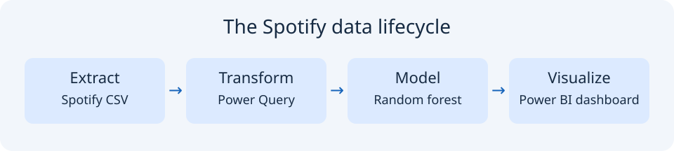

export const LifecyclePipeline = () => {
  const [sel, setSel] = useState(0);
  const stages = [
    { name: "Extract", what: "Pull raw data from where it lives.", example: "Download dataset.csv from Kaggle and open it.", tool: "Kaggle, Power BI Get Data, pandas read_csv", skip: "Without data, nothing else can happen." },
    { name: "Transform", what: "Clean and reshape the data so it is trustworthy.", example: "Fix data types, drop blank rows, remove duplicate tracks, add the viral label.", tool: "Power Query, pandas", skip: "Duplicates and errors would flow into every chart and prediction." },
    { name: "Model", what: "Find patterns and make predictions.", example: "Train a random forest to predict whether a track will go viral.", tool: "Python, scikit-learn, Colab", skip: "You could describe the past, but not estimate what is likely next." },
    { name: "Visualize", what: "Present results so people can act on them.", example: "A dashboard of popularity by genre, plus predicted viral probability.", tool: "Power BI", skip: "Decision-makers never see the insight, so nothing changes." },
  ];
  const s = stages[sel];
  return (
    

      
Try it: follow the data

      
Tap each stage to see what happens in our Spotify project.

      

        {stages.map((x, i) => (
          
            <button onClick={() => setSel(i)} className="px-3 py-1 rounded-md border border-zinc-300 dark:border-zinc-600" style={sel === i ? { background: "#1DB954", color: "white", borderColor: "#1DB954" } : {}}>{i + 1}. {x.name}</button>
            {i + 1 === stages.length ? null : &rarr;}
          
        ))}
      

      

        
{s.what}

        
<strong>In our project:</strong> {s.example}

        
<strong>Tools:</strong> {s.tool}

        
<strong>If you skip it:</strong> {s.skip}

      

    

  );
};

<LifecyclePipeline />

### 2.4 Data Cleaning

A commonly quoted rule of thumb says about **80% of data work is cleaning**. It is a rough figure, not a law, but the point is real: models and charts are only as good as the data under them. 

Examples you will meet in the Spotify data:

- **Duplicate tracks.** The same song appears once per genre it is tagged with, so it can be counted several times.
- **Missing values.** A few rows have no track name or artist.
- **Wrong data types.** A number stored as text cannot be averaged.

<Warning>
**The cost of bad data.** If duplicates make one song look five times as common, your model may "learn" that its features matter five times more than they do. A wrong prediction leads to a wrong decision about where to spend money, and that is a real cost.
</Warning>

**What does "good data" mean?**

| Quality | Question | Spotify example |
| --- | --- | --- |
| **Completeness** | Is anything missing? | A blank `track_name` |
| **Validity** | Are values allowed? | `danceability` of 1.7 (the scale is 0 to 1) |
| **Uniqueness** | Is each item counted once? | The same `track_id` in several genres |
| **Consistency** | Does it agree everywhere? | `explicit` stored as both "True" and "1" |
| **Accuracy** | Is it actually correct? | A tempo of 2000 BPM |
| **Timeliness** | Is it up to date? | Popularity scores from years ago |

**How we fix common problems**

| Problem | Typical fix |
| --- | --- |
| Missing values | Remove the row, or fill it in (for example, with the average) |
| Duplicates | Keep one row per unique ID |
| Wrong data type | Convert the column (text to number) |
| Impossible values | Remove them, or check the source |
| Outliers | Investigate before deciding: they may be real |

<Tip>
  Never clean blindly. Record each step you take so someone else can repeat it and trust the result. Power Query does this automatically in its "Applied steps" list.
</Tip>

**Data and responsibility**

Even harmless-looking data can be sensitive. Before using a dataset, ask where it came from, whether it contains personal information, and whether you have permission to use it. Our Spotify dataset describes songs, not listeners, which is part of why it's safe to use in a workshop.

export const SpotTheProblem = () => {
  const cols = ["track_id", "track_name", "track_genre", "popularity", "danceability", "tempo"];
  const rows = [
    ["5SuOik", "Comedy", "pop", "73", "0.676", "87.9"],
    ["4qPNDB", "Ghost - Acoustic", "acoustic", "55", "0.420", "77.5"],
    ["5SuOik", "Comedy", "dance", "73", "0.676", "87.9"],
    ["6lfxq3", "", "rock", "40", "0.500", "120.0"],
    ["0nbXyq", "Hold On", "pop", "N/A", "0.800", "130.0"],
    ["2ypxAs", "Rain", "jazz", "61", "1.700", "98.0"],
    ["1hP3Wc", "Sunrise", "pop", "-5", "0.600", "110.0"],
    ["7qiZfP", "Night Drive", "electronic", "66", "0.720", "2000.0"],
  ];
  const problems = {
    "2-track_id": "Row 3 repeats the track_id of row 1 (the same song tagged with a second genre). It would be counted twice.",
    "3-track_name": "Row 4 has no track name. A blank value that should be removed or handled.",
    "4-popularity": "Row 5 has the text N/A in a number column, so it can't be averaged.",
    "5-danceability": "Row 6 has danceability 1.7, but the scale only goes from 0 to 1.",
    "6-popularity": "Row 7 has popularity -5, but popularity runs from 0 to 100.",
    "7-tempo": "Row 8 has a tempo of 2000 BPM. No real song is that fast.",
  };
  const keys = Object.keys(problems);
  const [flagged, setFlagged] = useState([]);
  const [checked, setChecked] = useState(false);
  const toggle = (k) => {
    if (checked) return;
    if (flagged.includes(k)) { setFlagged(flagged.filter((f) => f !== k)); } else { setFlagged(flagged.concat([k])); }
  };
  const found = keys.filter((k) => flagged.includes(k)).length;
  const wrong = flagged.filter((k) => !keys.includes(k)).length;
  const reset = () => { setFlagged([]); setChecked(false); };
  const cellStyle = (k) => {
    const isProblem = keys.includes(k);
    const isFlag = flagged.includes(k);
    if (checked) {
      if (isProblem && isFlag) return { background: "rgba(29,185,84,0.35)" };
      if (isProblem) return { outline: "2px solid #F59E0B" };
      if (isFlag) return { background: "rgba(239,68,68,0.35)" };
      return {};
    }
    return isFlag ? { background: "rgba(59,130,246,0.35)" } : {};
  };
  return (
    

      

        
Data Detective

        
Six errors are hiding in this slice of the Spotify data. Tap any cell you think is wrong to flag it, then press Check.

        

          {flagged.length} flagged
           {keys.length} hidden
        

      

      

        <table className="text-sm w-full" style={{ borderCollapse: "separate", borderSpacing: 3 }}>
          <thead>
            <tr>{cols.map((c) => <th key={c} className="text-left px-2 py-1 font-mono text-xs" style={{ background: "rgba(29,185,84,0.18)", borderRadius: 6 }}>{c}</th>)}</tr>
          </thead>
          <tbody>
            {rows.map((row, ri) => (
              <tr key={ri}>
                {row.map((v, ci) => {
                  const k = ri + "-" + cols[ci];
                  return <td key={k} onClick={() => toggle(k)} className="px-2 py-2 cursor-pointer font-mono text-xs hover:opacity-70" style={Object.assign({ borderRadius: 6, background: "rgba(127,127,127,0.10)" }, cellStyle(k))}>{checked ? (keys.includes(k) ? (flagged.includes(k) ? " " : " ") : (flagged.includes(k) ? "❌ " : "")) : (flagged.includes(k) ? "🚩 " : "")}{v === "" ? "\u00A0" : v}</td>;
                })}
              </tr>
            ))}
          </tbody>
        </table>
      

      

        <button onClick={() => setChecked(true)} className="px-4 py-2 rounded-lg text-sm font-semibold" style={{ background: "#1DB954", color: "white" }}>Check my answers</button>
        <button onClick={reset} className="px-4 py-2 rounded-lg border border-zinc-300 dark:border-zinc-600 text-sm">Start over</button>
      

      {checked ? (
        

          

            
{found === keys.length && wrong === 0 ? " Perfect detective work!" : found >= 4 ? " Nice catch!" : " Good start, take another look"}

            
You found {found} of {keys.length}{wrong > 0 ? ", with " + wrong + " false alarm" + (wrong === 1 ? "" : "s") : ""}. found,  missed,  not an error.

          

          
What was hiding in the data

          <ul className="m-0">
            {keys.map((k) => <li key={k}>{problems[k]}</li>)}
          </ul>
        

      ) : null}
    

  );
};

<SpotTheProblem />

export const Reveal = ({ question, answer }) => {
  const [show, setShow] = useState(false);
  return (
    

      
{question}

      <button onClick={() => setShow(!show)} className="mt-2 px-3 py-1 rounded-md text-sm font-semibold" style={{ background: show ? "transparent" : "#1DB954", color: show ? "inherit" : "white", border: "1px solid #1DB954" }}>{show ? "Hide answer" : "Reveal answer"}</button>
      {show ? 
{answer}
 : null}
    

  );
};

---

## 3. Visual Analytics with Power BI

### 3.1 Connecting data

Power BI can read data in two main ways:

| | Flat file (CSV) | Live database connection |
|---|---|---|
| **What it is** | A snapshot saved in a file | A direct link to a database |
| **Updates** | Only when you re-import | Can refresh automatically |
| **Best for** | Learning, one-off analysis | Production dashboards |

We use a CSV today because it is simple and needs no server.

### 3.2 Dimensions vs measures

This one idea unlocks most of Power BI.

- A **dimension** is a category you *slice by*: genre, explicit (yes/no), key.
- A **measure** is a number you *calculate*: average popularity, count of tracks, average energy.

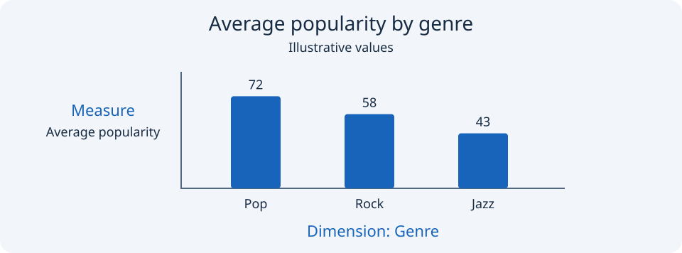

export const SortGame = () => {
  const items = [
    { n: "track_genre", a: "Dimension", why: "A category. You slice by it, you can't average it." },
    { n: "popularity", a: "Measure", why: "A number you can average: average popularity." },
    { n: "tempo", a: "Measure", why: "Beats per minute. Averaging it makes sense." },
    { n: "explicit", a: "Dimension", why: "True/False is a category: explicit or not." },
    { n: "track_name", a: "Dimension", why: "A label that identifies a row. Text, not a quantity." },
    { n: "energy", a: "Measure", why: "A 0 to 1 score you can average." },
    { n: "key", a: "Dimension", why: "Stored as a number (0 to 11) but it names a musical key. Averaging keys is meaningless, so it's a category." },
    { n: "duration_ms", a: "Measure", why: "Track length. Averaging gives an average length." },
  ];
  const [ans, setAns] = useState({});
  const done = Object.keys(ans).length;
  const score = items.filter((i) => ans[i.n] === i.a).length;
  return (
    

      
Try it: dimension or measure?

      
Tap a button for each column in the Spotify dataset.

      

        {items.map((i) => {
          const picked = ans[i.n];
          return (
            

              

                <code>{i.n}</code>
                
                  {["Dimension", "Measure"].map((o) => (
                    <button key={o} onClick={() => !picked && setAns({ ...ans, [i.n]: o })} className="ml-2 px-3 py-1 rounded-md border border-zinc-300 dark:border-zinc-600" style={picked === o ? { background: o === i.a ? "#1DB954" : "#EF4444", color: "white" } : {}}>{o}</button>
                  ))}
                
              

              {picked ? 
{picked === i.a ? "Correct. " : "Not quite: it's a " + i.a.toLowerCase() + ". "}{i.why}
 : null}
            

          );
        })}
      

      

        
{done === items.length ? "Score: " + score + " / " + items.length : done + " of " + items.length + " answered"}

        <button onClick={() => setAns({})} className="px-3 py-1 rounded-md border border-zinc-300 dark:border-zinc-600 text-sm">Reset</button>
      

    

  );
};

<SortGame />

### 3.3 Choosing the right visual

| Goal | Chart | Spotify example |
|---|---|---|
| Compare categories | Bar chart | Average popularity by genre |
| Spot a relationship between two numbers | Scatter plot | Energy vs valence (happiness) |
| Show one headline number | KPI card | Percentage of viral tracks |

export const ChartChooser = () => {
  const qs = [
    { q: "How does loudness relate to energy?", a: "Scatter plot", why: "Two numbers against each other: a scatter plot shows whether they rise together." },
    { q: "Which genres have the highest average popularity?", a: "Bar chart", why: "Comparing a measure across categories is exactly what a bar chart is for." },
    { q: "What share of all tracks are viral?", a: "KPI card", why: "One headline number. A card makes it impossible to miss." },
    { q: "Do happier songs (higher valence) tend to be more danceable?", a: "Scatter plot", why: "Again a relationship between two numbers, so a scatter plot." },
  ];
  const opts = ["Bar chart", "Scatter plot", "KPI card"];
  const [i, setI] = useState(0);
  const [pick, setPick] = useState(null);
  const [score, setScore] = useState(0);
  const finished = i >= qs.length;
  const cur = qs[Math.min(i, qs.length - 1)];
  const choose = (o) => { if (pick) return; setPick(o); if (o === cur.a) setScore(score + 1); };
  const next = () => { setPick(null); setI(i + 1); };
  const restart = () => { setI(0); setPick(null); setScore(0); };
  return (
    

      
Try it: pick the right chart

      {finished ? (
        

          
You got {score} of {qs.length}.

          <button onClick={restart} className="px-3 py-1 rounded-md border border-zinc-300 dark:border-zinc-600 text-sm">Try again</button>
        

      ) : (
        

          
Question {i + 1} of {qs.length}

          
{cur.q}

          

            {opts.map((o) => (
              <button key={o} onClick={() => choose(o)} className="px-3 py-1 rounded-md border border-zinc-300 dark:border-zinc-600" style={pick === o ? { background: o === cur.a ? "#1DB954" : "#EF4444", color: "white" } : {}}>{o}</button>
            ))}
          

          {pick ? (
            

              
<strong>{pick === cur.a ? "Correct." : "Not quite. The best choice is " + cur.a + "."}</strong> {cur.why}

              <button onClick={next} className="px-3 py-1 rounded-md border border-zinc-300 dark:border-zinc-600 text-sm">{i + 1 < qs.length ? "Next question" : "See score"}</button>
            

          ) : null}
        

      )}
    

  );
};

<ChartChooser />

**Track-specific examples**

- **Bar chart:** average popularity (measure) by genre (dimension).
- **Scatter plot:** each dot is a group, such as a genre; position shows two audio features.
- **KPI card:** the share of tracks that count as viral.

### 3.4 KPIs

A **KPI** (Key Performance Indicator) is one number that tells you, at a glance, how well something is going. On a dashboard, KPIs sit at the top because they answer the first question anyone asks: _"So, how are we doing?"_

A KPI is not just any number. A good one is:

- **Meaningful:** tied to a real goal. "Share of tracks that go viral" matters to a record label; "number of columns in the file" does not.
- **Single:** one number, one idea.
- **Comparable:** it means more with context, such as a target, last month, or another group.
- **Simple to read:** a person should get it in about three seconds.

**KPIs for our Spotify dashboard**

| KPI | What it answers | Calculation in Power BI |
| --- | --- | --- |
| **Total tracks** | How big is our catalogue? | Count of `track_id` |
| **Average popularity** | How popular is a typical track? | Average of `popularity` |
| **Viral share** | What percentage of tracks go viral? | A measure (built on Day 2) |
| **Average energy of viral tracks** | Do viral tracks sound different? | Average of `energy`, filtered to viral |

<Note>
  Every KPI is a **measure** (a calculated number), but not every measure deserves to be a KPI. Choose the few that drive decisions.
</Note>

**Card vs KPI visual**

Power BI has two ways to show a headline number:

|  | **Card** | **KPI visual** |
| --- | --- | --- |
| Shows | One value | A value, a target, and a trend |
| Needs | Just the measure | A measure, a target, and a time or category axis |
| Best for | "How many?" and "How much?" | "Are we hitting our goal?" |

We use **Cards** in this workshop because they are the simplest. The KPI visual becomes useful once you have a goal to compare against, for example _"Our aim is 15% viral share"_.

**Common KPI mistakes**

- **Wrong aggregation.** Summing `popularity` gives a meaningless number. Average it.
- **No context.** "Viral share: 12%" is hard to judge. Is that high or low? Add a target, or compare genres using the slicer.
- **Too many.** Five to six cards is plenty. More just hides the story.
- **Vanity numbers.** A big total that nobody can act on is not a KPI.

<Note>
**Heads-up about the dataset:** it has a `popularity` score (0–100) but no raw stream counts, so wherever you see "streams" in other material, we use **popularity** instead.
</Note>

### 3.5 How this connects to Day 2's ML model

Every pattern you spot in a chart is a *hypothesis* about which features drive popularity. On Day 2 you will write those hypotheses down, then check whether the model agrees. Dashboard first, model second.

### 3.6 Mini-demo: California Housing

Before touching Spotify, we practice on something simpler. The **California Housing** dataset is built into Google Colab at `/content/sample_data/california_housing_train.csv`.

<Steps>
  <Step title="Get the file">
    Download the [california_housing_train.csv](https://raw.githubusercontent.com/ageron/handson-ml/master/datasets/housing/housing.csv) dataset directly, or in Colab, open the Files panel on the left sidebar, go to `sample_data`, and download it from there.
  </Step>
  <Step title="Load it into the Power BI Web App">
    Go to **app.powerbi.com** and open your Workspace. Click **New** → **Upload a file** → select your CSV. Once loaded, click the dataset and select **Create a report** → **Start from scratch**.
  </Step>
  <Step title="Build The Map (Scatter Chart)">
    Add a **Scatter chart**. Put `longitude` on the **X-axis** and `latitude` on the **Y-axis** 

    _Format visual menu → Markers → Color → **fx** to apply a color gradient based on Average median_house_value)._
  </Step>
  <Step title="Add the Headlines (KPI Cards)">
    Add a **Card** visual to the blank canvas. Drag `median_house_value` into the card, click the dropdown arrow in the build pane, and change it from Sum to **Average**. Add a second **Card** next to it for `median_income` (also set to **Average**).
  </Step>
  <Step title="Add the Interactive Slicer">
    Add a **Slicer** visual to the canvas. Drag `housing_median_age` into it to create an interactive slider bar. Slide it to only show brand new houses and watch the map and KPI cards automatically recalculate!
  </Step>
  <Step title="Try it out ">
    Take some time to familiarize yourself and try building your own simple dashboard.
  </Step>
</Steps>

{/* ILLUSTRATION I-09: Screenshot of the finished housing scatter plot, showing the outline of California emerging from the dots, with callouts on step 3 settings. */}

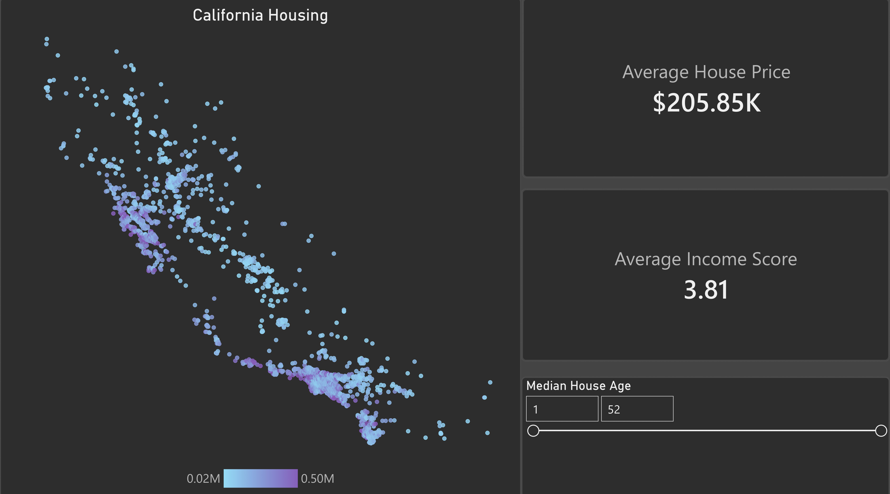

---

## 4. Machine Learning Fundamentals

### 4.1 What is machine learning?

Normally you write rules: *if energy is above 0.8, call it a hit.* In machine learning you give the computer many **examples** with known answers and let it **find the rules itself**. The algorithm finds mathematical patterns in past data and uses them to predict new cases.

### 4.2 Supervised vs unsupervised

- **Supervised learning:** every example comes with the right answer. *"Here are 100,000 songs and whether each went viral. Learn the link."*
- **Unsupervised learning:** no answers given. *"Here are 100,000 songs. Group similar ones together."*

<Note>
Our workshop uses **supervised learning**, because we know each track's popularity.
</Note>

### 4.3 Features and targets

- **Features** are the inputs: things we know about a song before release.
- **Target** (or **label**) is the output we want to predict.

{/* ILLUSTRATION I-10: Interactive "prediction machine". Features on the left as sliders (danceability, tempo, acousticness), a box labelled "model" in the middle, and "Viral / Not viral" on the right. Moving sliders changes the output with a toy rule so students see inputs → output. */}

| Role | Spotify columns |
|---|---|
| **Features** | `danceability`, `energy`, `loudness`, `speechiness`, `acousticness`, `instrumentalness`, `liveness`, `valence`, `tempo` |
| **Target** | `viral` (1 = viral, 0 = not viral) |

Because the target is a **category** (viral or not) rather than a number, this is a **classification** problem. If we predicted the exact popularity number, it would be **regression**.

### 4.4 Training vs testing, and overfitting

Imagine studying for an exam by memorising last year's paper word for word. You'd score 100% on *that* paper and fail a new one. Models do the same thing, and it is called **overfitting**.

To catch it, we split the data:

- **Training set (about 80%):** the model learns from this.
- **Testing set (about 20%):** hidden during learning, used only to grade the model on songs it has never seen.

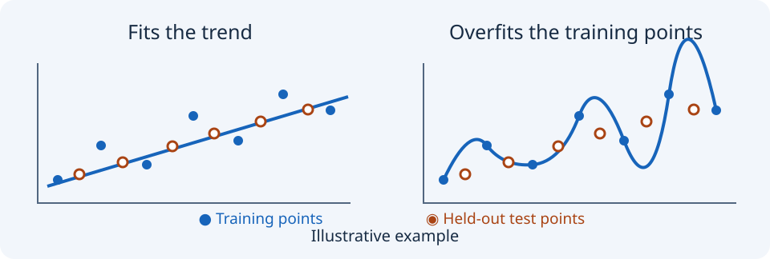

export const OverfitDemo = () => {
  const [depth, setDepth] = useState(3);
  const train = (d) => 0.62 + 0.37 * (1 - Math.exp(-d / 5));
  const test = (d) => 0.62 + 0.12 * (1 - Math.exp(-d / 2.5)) - 0.012 * Math.max(0, d - 6);
  const x = (d) => 40 + ((d - 1) / 19) * 320;
  const y = (a) => 170 - ((a - 0.55) / 0.5) * 150;
  const ds = Array.from({ length: 20 }, (_, i) => i + 1);
  const line = (f) => ds.map((d) => x(d) + "," + y(f(d))).join(" ");
  const gap = Math.round((train(depth) - test(depth)) * 100);
  const verdict = depth <= 3 ? "Too simple: it hasn't learned the pattern yet." : depth <= 7 ? "Sweet spot: learning real patterns." : "Memorising: great on training data, worse on new songs.";
  return (
    

      
Try it: how complex should the model be?

      <svg viewBox="0 0 380 200" className="w-full">
        <line x1="40" y1="170" x2="360" y2="170" stroke="currentColor" strokeOpacity="0.3" />
        <line x1="40" y1="20" x2="40" y2="170" stroke="currentColor" strokeOpacity="0.3" />
        <polyline points={line(train)} fill="none" stroke="#1DB954" strokeWidth="3" />
        <polyline points={line(test)} fill="none" stroke="#F59E0B" strokeWidth="3" />
        <line x1={x(depth)} y1="20" x2={x(depth)} y2="170" stroke="currentColor" strokeOpacity="0.5" strokeDasharray="4" />
        <circle cx={x(depth)} cy={y(train(depth))} r="5" fill="#1DB954" />
        <circle cx={x(depth)} cy={y(test(depth))} r="5" fill="#F59E0B" />
        <text x="45" y="16" fontSize="10" fill="currentColor">accuracy</text>
        <text x="250" y="194" fontSize="10" fill="currentColor">model complexity →</text>
      </svg>
      <input type="range" min="1" max="20" value={depth} onChange={(e) => setDepth(Number(e.target.value))} className="w-full" />
      
■ Training accuracy {Math.round(train(depth) * 100)}% &nbsp; ■ Test accuracy {Math.round(test(depth) * 100)}% &nbsp; Gap: {gap} points

      
{verdict}

      
Illustrative curves for teaching, not real model output.

    

  );
};

<OverfitDemo />

<Warning>
A model with great training accuracy but poor testing accuracy has not learned anything useful. Always judge a model on the **test** set.
</Warning>

### 4.5 Models 

There is no single best model. Each one learns patterns in a different way, and the right choice depends on your data and your goal. Here are five common ones for our "will this track go viral?" problem.

**1. Logistic regression: the weighted score**

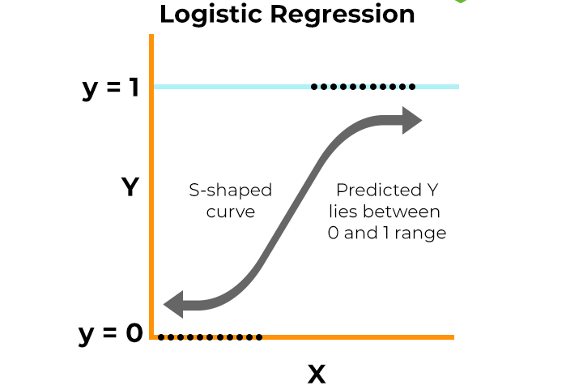

Despite the name, this is a **classification** model. It gives each feature a weight, adds up a score, and squashes that score into a probability between 0 and 1.

- **Spotify example:** high energy adds points, high acousticness subtracts points, and the total becomes "62% chance of going viral".
- **Strengths:** fast, simple, and easy to explain, because you can read the weights.
- **Weaknesses:** it only captures straight-line relationships.
- **Use it when:** you want a quick, understandable baseline.

**2. k-Nearest Neighbors (k-NN): ask your neighbors**

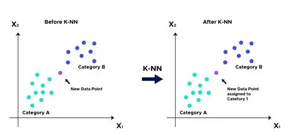

To judge a new song, it finds the _k_ most similar songs in the training data and takes a vote.

- **Spotify example:** a new track sounds like five known songs. Four were viral, so it predicts viral.
- **Strengths:** very intuitive, with no real "training" step.
- **Weaknesses:** slow on huge datasets, and sensitive to features on different scales (tempo goes up to 200 while danceability stops at 1).
- **Use it when:** you have a small dataset and similarity makes sense.

**3. Decision tree: a flowchart of questions**

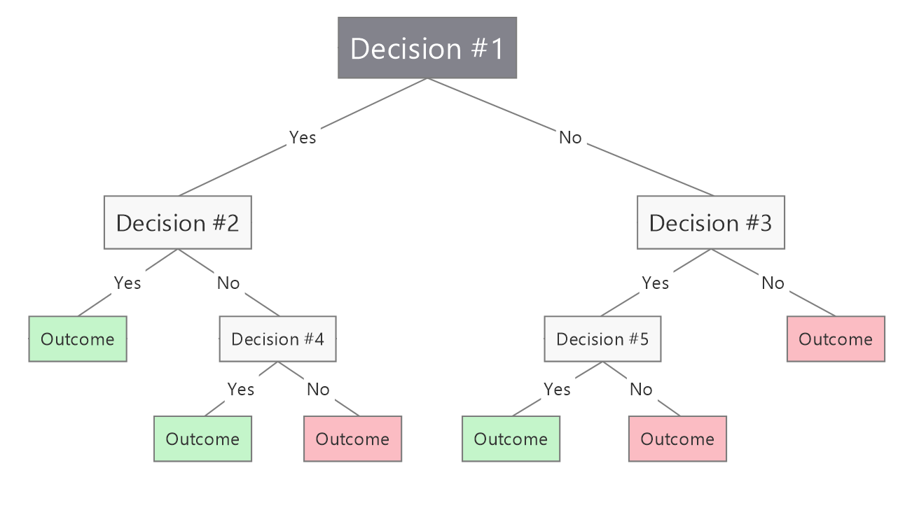

It asks a chain of yes/no questions: _Is energy above 0.6? Is acousticness below 0.3?_ Each answer leads to another question until it reaches a decision.

- **Strengths:** you can draw it and follow it, and it needs little data preparation.
- **Weaknesses:** one tree tends to **overfit**. It memorizes the training data.
- **Use it when:** explanation matters more than top accuracy.

**4. Random forest: a council of trees**

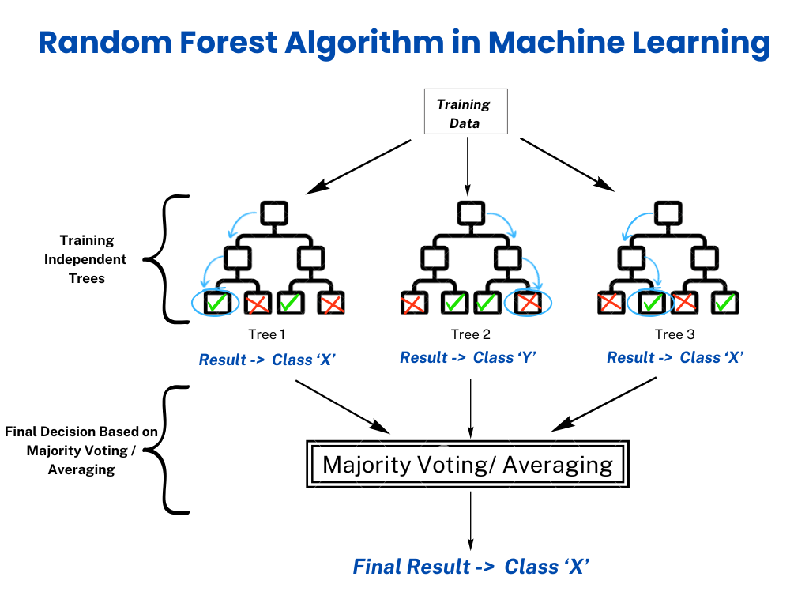

It builds hundreds of slightly different trees, each trained on a random slice of the data, and lets them **vote**. Averaging many opinions cancels out individual mistakes.

- **Strengths:** accurate, resistant to overfitting, handles messy data, and shows which features matter most.
- **Weaknesses:** harder to explain than one tree, and slower to train.
- **Use it when:** you want a strong, dependable model without much tuning. **This is the model we use on Day 2.**

**5. Gradient boosting: learning from mistakes**

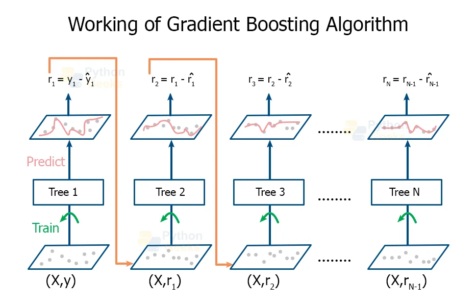

Trees are built **one after another**, and each new tree focuses on the songs the previous trees got wrong. Together they gradually improve. Popular versions include XGBoost and LightGBM.

- **Strengths:** often the most accurate on table-style data.
- **Weaknesses:** more settings to tune, and it can overfit if pushed too hard.
- **Use it when:** you want maximum accuracy and are comfortable tuning.

**Side by side**

| Model | Idea | Easy to explain? | Typical accuracy | scikit-learn class |
| --- | --- | --- | --- | --- |
| Logistic regression | Weighted score | Very | Medium | `LogisticRegression` |
| k-NN | Vote of similar songs | Yes | Medium | `KNeighborsClassifier` |
| Decision tree | Flowchart of questions | Yes | Medium | `DecisionTreeClassifier` |
| Random forest | Many trees vote | Somewhat | High | `RandomForestClassifier` |
| Gradient boosting | Trees fix each other's mistakes | Less | Highest | `HistGradientBoostingClassifier` |

<Tip>
  Start simple. A model you can explain, and that performs close to the fancy one, is often the better business choice.
</Tip>

**Supervised vs unsupervised: where do these fit?**

All five models above are **supervised**, since they learn from tracks with a known label. An unsupervised example is **k-means clustering**, which groups songs that sound alike with no labels at all. A label might use it to discover "types" of tracks before deciding what to predict.

### 4.6 How do we know a model is good?

Accuracy alone can mislead. If only 10% of tracks are viral, a model that says "not viral" every time is 90% accurate and completely useless. So we also look at:

- **Confusion matrix:** a 2 by 2 table of right and wrong predictions.
- **Precision:** of the tracks the model called viral, how many really were?
- **Recall:** of the tracks that really were viral, how many did the model find?

|  | Predicted viral | Predicted not viral |
| --- | --- | --- |
| **Actually viral** | Hit (true positive) | Missed hit (false negative) |
| **Actually not viral** | False alarm (false positive) | Correct rejection (true negative) |

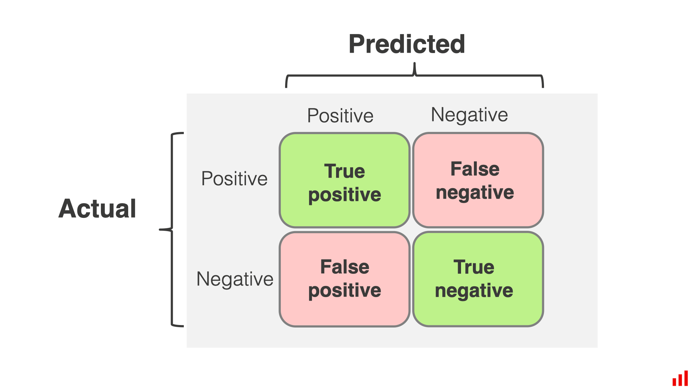

A record label might care most about **recall** (don't miss a future hit) or **precision** (don't waste marketing on a flop). The right metric depends on the business goal.

export const CouncilDemo = () => {
  const [energy, setEnergy] = useState(0.7);
  const [danceability, setDanceability] = useState(0.6);
  const [valence, setValence] = useState(0.5);
  const [acousticness, setAcousticness] = useState(0.2);
  const s = { energy: energy, danceability: danceability, valence: valence, acousticness: acousticness };
  const setters = { energy: setEnergy, danceability: setDanceability, valence: setValence, acousticness: setAcousticness };
  const trees = [
    { name: "Tree 1", rule: "energy above 0.6", vote: s.energy > 0.6 },
    { name: "Tree 2", rule: "danceability above 0.55", vote: s.danceability > 0.55 },
    { name: "Tree 3", rule: "valence above 0.4 and energy above 0.5", vote: s.valence > 0.4 && s.energy > 0.5 },
    { name: "Tree 4", rule: "acousticness below 0.3", vote: 0.3 > s.acousticness },
    { name: "Tree 5", rule: "danceability above 0.7 or energy above 0.8", vote: s.danceability > 0.7 || s.energy > 0.8 },
  ];
  const yes = trees.filter((t) => t.vote).length;
  const sliders = [["energy", "Energy"], ["danceability", "Danceability"], ["valence", "Valence (happiness)"], ["acousticness", "Acousticness"]];
  return (
    

      
Try it: the council votes

      
Describe a song with the sliders. Each tree applies its own simple rule and votes. The majority wins.

      {sliders.map(([k, label]) => (
        

          {label}: {s[k].toFixed(2)}
          <input type="range" min="0" max="1" step="0.05" value={s[k]} onChange={(e) => setters[k](Number(e.target.value))} className="flex-1" />
        

      ))}
      

        {trees.map((t) => (
          

            <strong>{t.name}</strong>: {t.rule}
            {t.vote ? "Viral" : "Not viral"}
          

        ))}
      

      
Council decision: {yes >= 3 ? "Viral" : "Not viral"} ({yes} of 5 votes)

      
Toy rules for teaching. A real forest learns hundreds of rules from data.

    

  );
};

<CouncilDemo />

We will use a **random forest** on Day 2.

export const Reveal = ({ question, answer }) => {
  const [show, setShow] = useState(false);
  return (
    

      
{question}

      <button onClick={() => setShow(!show)} className="mt-2 px-3 py-1 rounded-md text-sm font-semibold" style={{ background: show ? "transparent" : "#1DB954", color: show ? "inherit" : "white", border: "1px solid #1DB954" }}>{show ? "Hide answer" : "Reveal answer"}</button>
      {show ? 
{answer}
 : null}
    

  );
};

---

## 5. Production Pipelines

A model sitting in a notebook helps nobody. To be useful, it has to be **deployed** so other systems can use it.

### 5.1 The model's life after training

Training is only the middle of the story. A complete workflow looks like this:

<Steps>
  <Step title="Collect and prepare data">
    Gather and clean the data (Session 2).
  </Step>
  <Step title="Train and test">
    Build the model and check it on unseen data (Session 4).
  </Step>
  <Step title="Deploy">
    Make the model available to people or systems.
  </Step>
  <Step title="Monitor">
    Track whether predictions stay accurate.
  </Step>
  <Step title="Retrain">
    Update the model when performance drops, then repeat.
  </Step>
</Steps>

This loop is often called **MLOps**: machine learning plus the operational habits that keep it running.

### 5.2 Deployment and APIs

The most common approach is to wrap the model in an **API** (Application Programming Interface): a doorway other software can knock on.

1. A label's A&R app sends a track's audio features to the API.
2. The API runs the model.
3. It sends back a prediction, for example "62% chance of going viral".

Getting an answer on demand like this is called **real-time inference**.

**Batch vs real-time predictions**

|  | Batch | Real-time |
| --- | --- | --- |
| **When** | On a schedule (nightly, weekly) | The moment someone asks |
| **Example** | Score every new release each Monday | A label's app scores one demo upload instantly |
| **Pros** | Simple, cheap | Instant answers |
| **Cons** | Results can be stale | More complex infrastructure |

Our Day 2 export to Power BI is a small example of **batch** scoring.

**Other ways models get used**

- **Inside an app** (a recommendation shown to a listener).
- **In a spreadsheet or dashboard** (predictions loaded into Power BI).
- **As a report** (a monthly list of likely hits).

{/* ILLUSTRATION I-13: Animated request/response flow: App → API → Model → App, with a sample JSON request and response that students can edit (change energy and see a new fake probability). */}

### 5.3 Model drift

The world changes, and models don't notice. This is **model drift**.

- Music tastes shift: what was a hit in 2015 may not be today.
- Platforms change their recommendation algorithm.
- A new trend (for example a viral dance) changes what listeners want.

A model trained on old data slowly becomes less accurate. Teams **monitor** accuracy and **retrain** with fresh data when it drops.

export const DriftDemo = () => {
  const start = 2015;
  const end = 2026;
  const [year, setYear] = useState(start);
  const [retrains, setRetrains] = useState([start]);
  const lastTrain = (y) => Math.max(...retrains.filter((r) => r <= y));
  const acc = (y) => Math.max(0.55, 0.85 - 0.025 * (y - lastTrain(y)));
  const taste = (y) => 0.6 + 0.012 * (y - start);
  const years = Array.from({ length: year - start + 1 }, (_, i) => start + i);
  const x = (y) => 40 + ((y - start) / (end - start)) * 320;
  const yy = (a) => 170 - ((a - 0.5) / 0.4) * 150;
  const pts = years.map((y) => x(y) + "," + yy(acc(y))).join(" ");
  const retrain = () => { if (!retrains.includes(year)) setRetrains([...retrains, year]); };
  const reset = () => { setRetrains([start]); setYear(start); };
  const a = Math.round(acc(year) * 100);
  return (
    

      
Try it: watch a model drift

      
Move through the years. Listener tastes change, and a model trained on old data slowly gets worse.

      <svg viewBox="0 0 380 200" className="w-full">
        <line x1="40" y1="170" x2="360" y2="170" stroke="currentColor" strokeOpacity="0.3" />
        <line x1="40" y1="20" x2="40" y2="170" stroke="currentColor" strokeOpacity="0.3" />
        <polyline points={pts} fill="none" stroke="#1DB954" strokeWidth="3" />
        {retrains.map((r) => r <= year ? <line key={r} x1={x(r)} y1="20" x2={x(r)} y2="170" stroke="#F59E0B" strokeDasharray="4" /> : null)}
        <circle cx={x(year)} cy={yy(acc(year))} r="5" fill="#1DB954" />
        <text x="45" y="16" fontSize="10" fill="currentColor">model accuracy</text>
        <text x="40" y="190" fontSize="10" fill="currentColor">{start}</text>
        <text x="340" y="190" fontSize="10" fill="currentColor">{end}</text>
      </svg>
      <input type="range" min={start} max={end} value={year} onChange={(e) => setYear(Number(e.target.value))} className="w-full" />
      
<strong>Year {year}</strong>. Average danceability of hits: {taste(year).toFixed(2)}. Model last trained in {lastTrain(year)}. Accuracy: <strong>{a}%</strong>

      
{a >= 80 ? "Healthy: the model still matches how listeners behave." : a >= 70 ? "Slipping: time to check the monitoring." : "Drifted: retrain on recent data."}

      

        <button onClick={retrain} className="px-3 py-1 rounded-md border border-zinc-300 dark:border-zinc-600 text-sm">Retrain now (dashed line)</button>
        <button onClick={reset} className="px-3 py-1 rounded-md border border-zinc-300 dark:border-zinc-600 text-sm">Reset</button>
      

      
Illustrative numbers for teaching, not real data.

    

  );
};

<DriftDemo />

export const Reveal = ({ question, answer }) => {
  const [show, setShow] = useState(false);
  return (
    

      
{question}

      <button onClick={() => setShow(!show)} className="mt-2 px-3 py-1 rounded-md text-sm font-semibold" style={{ background: show ? "transparent" : "#1DB954", color: show ? "inherit" : "white", border: "1px solid #1DB954" }}>{show ? "Hide answer" : "Reveal answer"}</button>
      {show ? 
{answer}
 : null}
    

  );
};

**Responsible deployment checklist**

- Do we know what the model should **not** be used for?
- Does it perform fairly across genres and not just the popular ones?
- Can a human review decisions that matter?
- Who is responsible when it is wrong?

<Note>
  A model that predicts "viral" is a tool to support a decision, not to replace the people who make it.
</Note>
