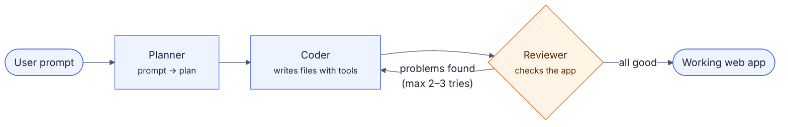

# Build an AI App-Builder Agent (120 min)

**What we build:** a mini Lovable. You type *"Build a habit tracker with streaks and a dark theme"*. The agent plans the app, writes the files, checks its own work, fixes mistakes and gives you a working app.



## Setup (do this before Day 2)

1. Install **Python 3.12+**, **Git** and **VS Code**.
2. Get a free **Groq API key** at https://console.groq.com
3. Clone the workshop repo *(link TBA)* and install the dependencies:

```bash
git clone <REPO_LINK>
cd <REPO_FOLDER>
pip install -r requirements.txt
```

4. Create a `.env` file in the repo folder:

```
GROQ_API_KEY=your_key_here
```

⚠️ Never push your `.env` file to GitHub.

*(Exact commands will be updated once the repo is final.)*

## Day 2 Plan

| # | Topic | Time |
|---|---|---|
| 1 | Setup check & see the final result | 10 |
| 2 | State & the graph | 15 |
| 3 | Planner agent: prompt → structured plan | 20 |
| 4 | Coder agent: file tools & the coding loop | 25 |
| – | Break | 5 |
| 5 | Run it end-to-end | 10 |
| 6 | Reviewer loop: the agent checks & fixes itself | 20 |
| 7 | Challenges, GitHub & next steps | 15 |

### 1. Setup Check & Final Result (10 min)
- Fix any setup problems in a separate breakout room or chat thread
- Demo the finished agent first, so everyone sees what they're building

### 2. State & the Graph (15 min)
- Define what the agent needs to remember: the prompt, the plan, the files and any errors
- Create the graph and connect the nodes

### 3. Planner Agent (20 min)
- Turn the user's prompt into a structured plan (app name, features, files)
- Use structured output, so the plan is reliable

### 4. Coder Agent & Tools (25 min)
- Give the agent file tools: read, write, list
- Write one file per step and loop until every file is done
- Watch the files appear in VS Code

### 5. Run It End-to-End (10 min)
- Try a fresh prompt and open the generated app
- Spot bugs. Why didn't the agent catch them?

### 6. Reviewer Loop (20 min)
- Add a reviewer that checks the app for problems
- If it finds problems, send them back to the coder to fix
- Cap the number of retries, so it can't loop forever
- Break something on purpose and watch the agent fix it

### 7. Challenges & Next Steps (15 min)
**Pick one challenge:**
- Let the LLM choose its own tools (a real tool-calling agent)
- Add human approval before coding starts
- Add an AI reviewer that checks the app against the planned features
- Let the agent edit an existing app

**Push to GitHub** with a README (diagram, tech stack, setup, demo GIF). It makes a solid portfolio project.

**Learn next:** MCP · multi-agent systems · agent evals · LangSmith · FastAPI + Docker

---

## Wrap Up

- **Day 1:** what makes AI *agentic*: tools, loops, memory, patterns and LangGraph
- **Day 2:** building an agent that plans, codes, checks and fixes its own work 🚀

---

### References

- Anthropic, "Building effective agents": https://www.anthropic.com/engineering/building-effective-agents
- LangGraph docs: https://docs.langchain.com/oss/python/langgraph/overview
- Inspired by Codebasics' Lovable-clone LangGraph project
